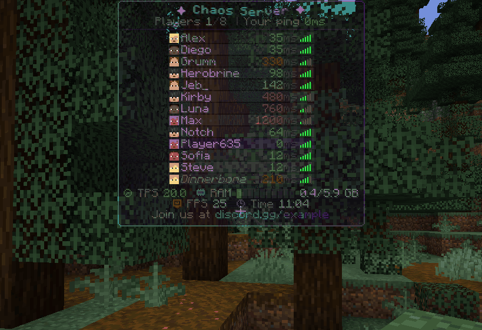
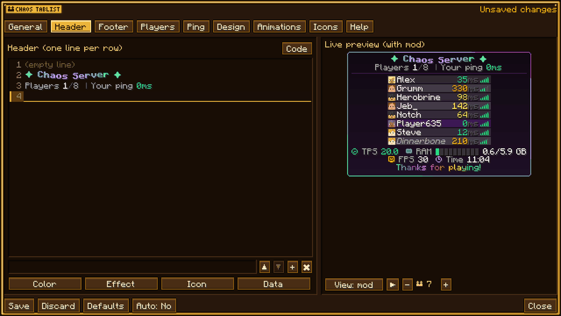
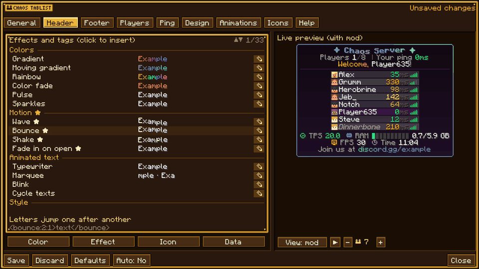
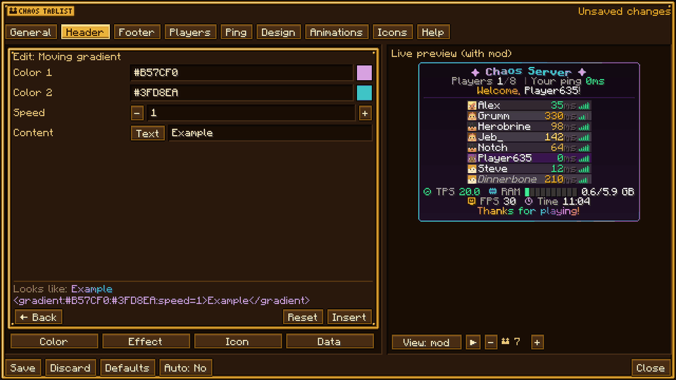
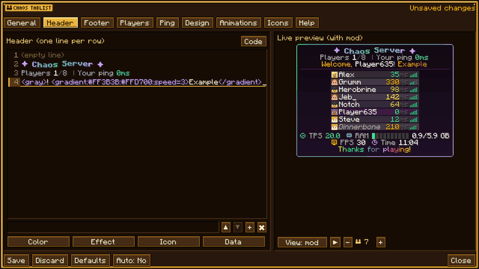
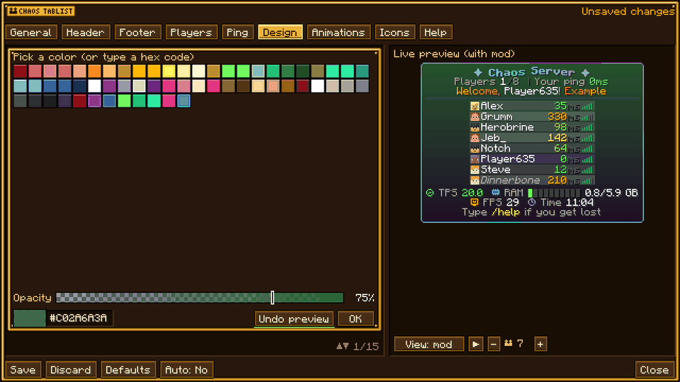
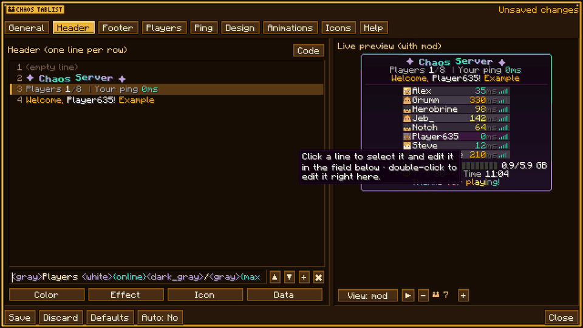
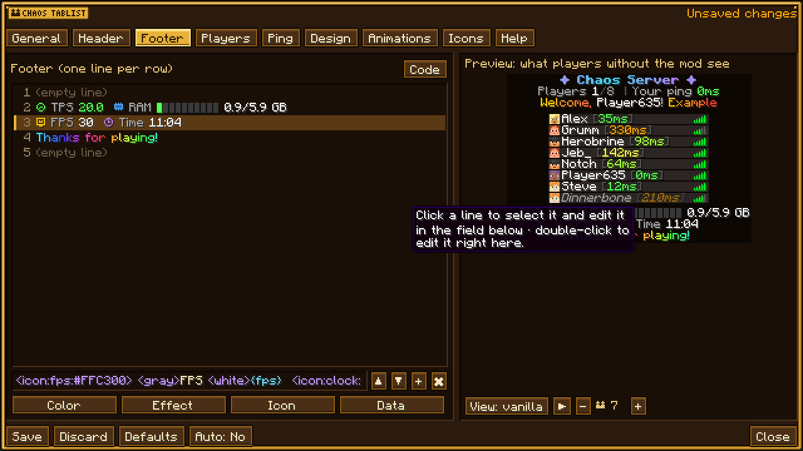

# Chaos Tablist

Mod para Fabric, Forge y NeoForge (Minecraft 26.3) para personalizar el Tab al máximo: header y footer con varias líneas, rango de cada jugador con Chaos Ranks, ping, degradados, fade, arcoíris, animaciones por letra, fondos detrás del texto, iconos y badges en pixel art (como los de Chaos Ranks), datos del servidor (TPS, RAM, CPU…) y del cliente (FPS, RAM, hora). Todo se edita **en caliente** con `/tablist` desde un menú propio con vista previa en vivo, y queda guardado en el servidor.

Es **híbrido**:
- **Solo en el servidor** ya funciona con clientes vanilla: el servidor monta el Tab y lo manda por los paquetes normales (header, footer y nombre de cada jugador), con las animaciones al ritmo de `updateTicks`.
- **Con el mod también en el cliente** el Tab lo pinta el propio cliente a cada frame: animaciones suaves a los FPS del juego, fondos detrás del texto, transparencia, ola, temblor, contorno, brillo, cabezas, ítems, imágenes PNG propias, panel con borde degradado animado, animación al abrir… y placeholders del cliente como `{fps}` o `{client_ram}`. El editor `/tablist` necesita el mod en el cliente.

Lo que solo se ve con el mod (marcado con ★ en el editor) en vanilla simplemente no se aplica, sin romper el texto. Los iconos y badges salen como un símbolo de respaldo (`♛`, `★`, `[VIP]`…).

## Fabric, Forge y NeoForge (26.3 · 1.2.0)

El proyecto usa la misma separación que Chaos Ranks: `common/` contiene el editor, renderizado, configuración, texto, comandos y pruebas; `fabric/`, `forge/` y `neoforge/` contienen únicamente los eventos y la red nativa de cada cargador. No se necesita Architectury ni otra capa adicional al instalarlo.

| Variante | Requisitos | JAR |
|---|---|---|
| Fabric | Java 25, Fabric Loader 0.19.5+ y Fabric API para 26.3 | `fabric/build/libs/chaostablist-fabric-26.3-1.2.0.jar` |
| Forge | Java 25 y Forge 66.0.10+ de la serie 66 | `forge/build/libs/chaostablist-forge-26.3-1.2.0.jar` |
| NeoForge | Java 25 y NeoForge 26.3.0.76 para 26.3 | `neoforge/build/libs/chaostablist-neoforge-26.3-1.2.0.jar` |

Los tres cargadores pasan las pruebas dentro del juego y la simulación vanilla. El alcance de las pruebas está en VALIDATION.md. En el equipo de desarrollo Windows se usa `javaw.exe` con la preferencia existente de alto rendimiento; el arranque reproducible está en `tools/windows-gpu.init.gradle`. Consulta VALIDATION.md.

Los tres JAR listos para instalar están también en `dist/`. Consulta [VALIDATION.md](VALIDATION.md) para ver los resultados y las limitaciones de las pruebas.

Usa el JAR de tu cargador. En Forge y NeoForge no se necesita Fabric API. Instalarlo solo en el servidor conserva la vía vanilla; la vista avanzada y el editor necesitan el JAR del cargador correspondiente también en los clientes. Las tres variantes usan el mismo archivo `tablist.json`, las mismas plantillas, diseños e iconos.

### Compilar y probar

- Fabric: `./gradlew -Ploader=fabric build` (Gradle 9.7.1, Java 25).
- Forge: `./gradlew-forge build` con `JAVA_HOME` en Java 25 (Gradle 9.7.1).
- NeoForge: `./gradlew-neoforge build` con `JAVA_HOME` en Java 25 (Gradle 9.7.1).
- Windows: los mismos comandos con extensión `.bat`.
- Elige un cargador por ejecución. `build` ejecuta también las 85 comprobaciones de regresión.
- Prueba visual: `./gradlew -Ploader=fabric :fabric:runSelftest` o `./gradlew-forge -Pselftest :forge:runClient`; NeoForge: `./gradlew-neoforge :neoforge:runSelftest`.
- Simulación de clientes vanilla: `runSelftestVanilla` en Fabric y NeoForge; Forge: `-PselftestVanilla :forge:runClient`.
- Inicialización dedicada sin aceptar EULA ni cargar un mundo (no equivale a una partida dedicada): `:fabric:runServerSmoke`, `-PserverSmoke :forge:runServer` o `:neoforge:runServerSmoke`.

Las autopruebas abren o crean el mundo después de llegar al menú inicial. Cada cargador usa su propio mundo de desarrollo en `<cargador>/run/saves/selftest`. Las autopruebas modifican exclusivamente ese mundo; no deben apuntar a un mundo de producción. Los generadores de recursos escriben en `common/src/main/resources`. Para publicar manualmente, las herramientas de `tools/` aceptan `-Loader fabric`, `-Loader forge` o `-Loader neoforge`; `-DryRun` no publica nada.

## Mejoras de la versión 1.2.0

- **Guardado confirmado**: el editor solo marca el diseño como guardado cuando el servidor confirma que se escribió en disco. Ctrl+S guarda; cerrar con cambios pendientes permite guardar, descartar o volver al editor.
- **Conflictos entre administradores**: cada guardado incluye la revisión de la configuración. Si otro administrador la cambia, se conserva tu borrador y debes exportarlo o cargar la versión del servidor. **Recargar**, en la barra inferior del editor, carga esa versión; Ctrl+Z recupera el borrador anterior.
- **Recuperación**: cada guardado conserva el archivo anterior como `tablist.json.bak`. Un JSON inválido al arrancar o recargar se conserva intacto; al recargar se mantiene la configuración que ya estaba activa. La escritura prepara un archivo temporal y lo reemplaza al terminar.
- **Datos privados**: coordenadas, dimensión, vida y los demás datos personales se envían únicamente a su dueño. Nombre, ping, modo, equipo y rango son públicos. En **General → Datos públicos** puedes compartir campos adicionales deliberadamente, separados por comas, por ejemplo `world,health`. Vacío mantiene esos campos privados. Las plantillas de fila que usen datos privados de otros jugadores necesitan autorizar esos campos; el orden por mundo también requiere publicar `world`.
- **Diseños reutilizables**: **General → Diseños / importar** ofrece Chaos, Minimal y Ocean, además de archivos JSON guardados en `config/chaostablist/designs/` del cliente. **Exportar borrador** guarda una copia con nombre único. Para importar un archivo externo, abre la carpeta desde la biblioteca, añade su JSON y vuelve a abrir la biblioteca. Aplicar un diseño modifica el borrador y puede deshacerse; los presets conservan el nombre del servidor, los cambios por jugador y las opciones de privacidad.
- **Animaciones**: duplicación independiente, velocidades negativas de marquesina y hasta 64 fotogramas editables.
- **Diagnósticos**: avisos de etiquetas desconocidas, cierres incorrectos y delimitadores sin cerrar en el header y footer. La vista vanilla usa los mismos valores de respaldo que el servidor; su geometría sigue siendo una aproximación y se indica en pantalla.
- **Límites**: hasta 32 etiquetas anidadas y 2.048 glifos por plantilla evaluada; 64 animaciones y 512 excepciones de jugador. Los PNG admiten hasta 1.024 × 1.024 píxeles, 256 KB y nombres de 1–64 caracteres (`a-z`, números, `_`, `-`).
- **Rendimiento**: orden y entradas del cliente reutilizados entre frames, configuración comprimida una vez por revisión y recuento de entidades solo cuando se usa `{entities}`. Las actualizaciones periódicas se detienen con el Tab desactivado o sin jugadores.

Puedes ver la [biblioteca de diseños](screenshots/update-1.2.0/design_library.png), el [aviso de cambios pendientes](screenshots/update-1.2.0/unsaved_confirmation.png) y los [diagnósticos en el editor](screenshots/update-1.2.0/template_diagnostic.png) en las capturas de 1.2.0.

**Compatibilidad de red:** para la vista personalizada y el editor, actualiza el servidor y los clientes a 1.2.0. Los clientes con una versión anterior siguen usando la vía vanilla. Esta rama admite Minecraft 26.3 y requiere Java 25.

**Pruebas:** `./gradlew build` ejecuta también `regressionTest`, que comprueba persistencia, privacidad, compresión, validación, historial, confirmación de guardado y presets sin abrir Minecraft. `runSelftest` y `runSelftestVanilla` añaden capturas y comprobación del guardado confirmado en un mundo de desarrollo.

## Capturas

| | |
|---|---|
|  |  |
| El Tab con sus animaciones | Doble clic en una línea y escribir |
|  |  |
| Lista de efectos con ejemplos en vivo | ✎ Editor de un efecto: colores, velocidad, contenido |
|  |  |
| El efecto ya en el header | Vista previa del color antes de pulsar OK |
|  |  |
| Ctrl+Z deshace | Lo que ven los jugadores sin el mod |

Más capturas en [`screenshots/`](screenshots). Se regeneran con `./gradlew runShowcase` y `python tools/make_showcase.py`.

## Comandos (requiere OP, nivel 2)

| Comando | Qué hace |
|---|---|
| `/tablist` | Abre el editor (con vista previa en vivo) |
| `/tablist reload` | Vuelve a leer `tablist.json` y los iconos PNG |
| `/tablist toggle` | Activa o desactiva el Tab personalizado |
| `/tablist preview <texto>` | Evalúa una plantilla y la muestra en el chat (como la vería un cliente vanilla) |
| `/tablist player <jugadores> prefix\|format\|suffix <texto>` | Formato propio para esos jugadores |
| `/tablist player <jugadores> hide\|show\|reset` | Ocultar del Tab (con mod), mostrar o quitar sus cambios |

## El editor

Pestañas a la izquierda y el Tab en vivo a la derecha (con tus jugadores reales y jugadores de ejemplo con pings y modos distintos). Debajo de la vista previa: **Vista mod / vanilla** (para ver lo que ven los que no tienen el mod), **▶** (repite la animación de apertura) y cuántos jugadores de ejemplo mostrar.

- **General**: activar, nombre del servidor, refresco para vanilla, orden (rango, nombre, ping, modo, mundo, equipo), espectadores al final.
- **Header / Footer**: una línea por fila. Clic en una línea para editarla en el campo de abajo, o doble clic para editarla ahí mismo.
- **Jugadores**: cambios para un jugador concreto, u ocultarlo.
- **Ping**: barras, número, ambos, solo número u oculto; formato del número, sufijo para vanilla y colores por umbral.
- **Diseño**: fondo en degradado, borde de dos colores animado, esquinas, colores de fila (alterna y la tuya), alto de fila, márgenes, columnas, escala, cabezas, sombra, animación al abrir (caída, fundido, deslizar, zoom), estilo del marcador…
- **Animaciones**: animaciones por frames (`{anim:nombre}`), un frame por línea.
- **Iconos**: los 162 iconos (y los PNG propios); clic para copiar.
- **Ayuda**: todos los placeholders con su valor actual y todas las etiquetas con un ejemplo en vivo.

Los botones **Color / Efecto / Icono / Dato** meten la etiqueta en el cursor del último campo usado. En **Color**, **Vista previa** prueba el color en el Tab en vivo y solo se queda si pulsas **OK**. En **Efecto**, el botón **✎** de cada efecto abre su editor: colores, velocidad y demás opciones, y si va con un texto o con un icono, con vista previa antes de insertarlo. Todas las pestañas y botones tienen un tooltip que explica qué hacen. En los campos se puede seleccionar texto arrastrando el ratón (doble clic selecciona una palabra o una etiqueta entera) y copiar, cortar y pegar con Ctrl+C / Ctrl+X / Ctrl+V. **Ctrl+Z** deshace y **Ctrl+Y** (o Ctrl+Shift+Z) rehace cualquier cambio del editor. Los campos de plantilla colorean las etiquetas en morado y los placeholders en celeste. **Guardar** lo aplica a todo el servidor al momento; con **Auto: Sí** se guarda solo mientras escribes.

## Formato de texto

Estilo MiniMessage. `</>` cierra la última etiqueta; `\<` escribe un `<`.

| Etiqueta | Ejemplo |
|---|---|
| Color | `<#FF5555>`, `<red>`, `<gold>`, `&a`, `&#FF55FF`, `<color:#AARRGGBB>` |
| Estilo | `<b>`, `<i>`, `<u>`, `<st>`, `<obf>`, `<font:minecraft:uniform>`, `<smallcaps>`, `<upper>` |
| Degradado | `<gradient:#f00:#0f0:#00f>` · animado: `<gradient:#B57CF0:#3FD8EA:speed=1>` |
| Arcoíris | `<rainbow>` · animado: `<rainbow:1>` |
| Fundido / pulso | `<fade:#FF5555:#FFFF55:1>`, `<pulse:#FFFFFF:1>` |
| Destellos | `<sparkle:#FFFFFF>` |
| Máquina de escribir | `<typewriter:8:2:cursor=_>` (letras/s, pausa) |
| Marquesina | `<scroll:16:4>` (ancho, velocidad) |
| Parpadeo | `<blink:0.5:0.5>` |
| Alternar textos | `<cycle:2:fade=true>uno<next>dos<next>tres</cycle>` |
| Condición | `<if:{ping}:gt:150>lento<else>rápido</if>` (eq, ne, gt, lt, ge, le, contains, empty) |
| Color por ping | `<pc:{ping}>{ping}ms</pc>` (umbrales de la pestaña Ping) |
| Color por valor | `<scale:{tps}:15:20:#FF5555:#55FF55>{tps}</scale>` |
| Barra | `<bar:{ram_pct}:10:#55FF55:#3A3A3A:char=▌:to=#FF5555>` |
| Icono | `<icon:crown:#FFD700>` o `:crown:` |
| Badge | `<badge:VIP:#7B2CBF:#FFFFFF:star:#3B1A5C:true>` (texto, fondo, letras, icono, marco, negrita) |
| Alinear / espacio | `<left>`, `
`, `<right>`, `<space:6>`, ` ` |
| ★ Fondo | `<bg:#C0000000:2:true:#FFE8B23A>` (color, margen, redondeado, borde) |
| ★ Contorno / brillo / sombra | `<outline:#000>`, `<glow:#FFD700>`, `<shadow:#5A0F8C>`, `<noshadow>` |
| ★ Movimiento | `<wave:1.5:1>`, `<bounce>`, `<shake:0.6>` |
| ★ Transparencia | `<alpha:0.5>`, `<fadein:0.4:0.05>` (aparece al abrir el Tab, letra a letra) |
| ★ Cabeza / ítem / imagen | `<head:{player}>`, `<item:minecraft:diamond_sword>`, `<icon:custom/logo>`, `` |

## Placeholders

Servidor: `{player}` `{ping}` `{online}` `{max_players}` `{server_name}` `{motd}` `{version}` `{tps}` `{mspt}` `{ram}` `{ram_pct}` `{ram_used}` `{ram_max}` `{cpu}` `{uptime}` `{date}` `{time}` `{day}` `{world_time}` `{weather}` `{weather_icon}` `{is_day}` `{moon_phase}` `{staff_online}` `{afk_online}` `{difficulty}` `{view_distance}` `{sim_distance}` `{entities}` `{chunks}` `{worlds}` `{threads}` `{java_version}` `{server_mods}` `{port}`.

Jugador: `{world}` `{dimension}` `{biome}` `{x}` `{y}` `{z}` `{health}` `{max_health}` `{food}` `{level}` `{gamemode}` `{deaths}` `{kills}` `{mob_kills}` `{playtime}` `{afk}` `{op}` `{team}` `{display_name}` `{xp}` `{xp_pct}` `{armor}` `{saturation}` `{air}` `{light}` `{facing}` `{chunk_x}` `{chunk_z}` `{held_item}` `{language}` `{jumps}` `{fish}` `{walked}` `{since_death}`.

Cliente (★): `{fps}` `{client_ram}` `{client_ram_pct}` `{client_ram_used}` `{client_ram_max}` `{my_ping}` `{local_time}` `{local_time_s}` `{local_date}` `{local_weekday}` `{render_distance}` `{resolution}` `{gpu}` `{client_mods}`. Sin el mod salen como el texto de "Texto sin mod" (`-`), salvo la hora y el ping, que usan los del servidor.

Animaciones: `{anim:nombre}`.

## Formato de cada fila

Cada fila es `prefijo + nombre + sufijo`. Por defecto: el badge del rango de Chaos Ranks (si lo tiene) y el nombre en blanco. No se edita desde el menú: los rangos los gestiona Chaos Ranks. Se puede cambiar a mano en `tablist.json` (`row`) y, para un jugador concreto, en la pestaña **Jugadores**.

## Chaos Ranks (opcional)

Si Chaos Ranks está instalado se activan `{rank}` (el badge del rango, en la versión compacta del Tab), `{rank_name}`, `{rank_id}`, `{rank_priority}`, `{has_rank}` y el orden por rango. Los clientes vanilla ven el rango como `[NOMBRE]`. Se enlaza por reflexión, así que no hace falta para compilar ni para jugar.

## Datos

En `<mundo>/chaostablist/`:
- `tablist.json`: toda la configuración (se puede editar a mano y recargar con `/tablist reload`).
- `icons/*.png`: imágenes propias (máx. 64, 256 KB cada una, hasta 1.024 × 1.024 píxeles). Se mandan a los clientes con el mod y se usan con `<icon:custom/nombre>` o ``.

## Desarrollo

- `python tools/gen_font.py`: regenera la fuente de iconos y badges (`chaostablist:badge` y `badge_compact`) y `badge_meta.json` a partir del ASCII art del script, con el símbolo de respaldo de cada icono.
- `python tools/gen_gui.py`: texturas del editor.
- `python tools/gen_lang.py`: archivos de idioma (inglés y todas las variantes `es_*`).
- `python tools/gen_icon.py`: icono del mod.
- `./gradlew -Ploader=fabric build` o `./gradlew-forge build`: JAR en `<cargador>/build/libs/`.
- `./gradlew runSelftest`: capturas del Tab, de cada pestaña del editor y de los desplegables en `<cargador>/run/screenshots/selftest_*.png`, y prueba el guardado por red. Las autopruebas crean su propio mundo plano aislado en `<cargador>/run/saves/selftest`.
- `./gradlew runShowcase` + `python tools/make_showcase.py`: graba las capturas y los GIF de `screenshots/`.
- `./gradlew runSelftestVanilla`: lo mismo, pero el servidor trata al cliente como vanilla (para ver lo que reciben los clientes sin el mod).
- `powershell -File tools/upload-curseforge.ps1 -ProjectId <id> [-DryRun]`: sube el jar a CurseForge (token en `CURSEFORGE_TOKEN`).
